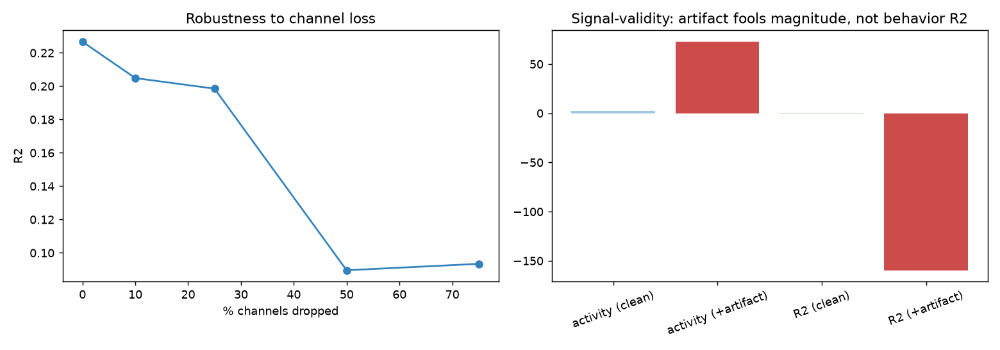
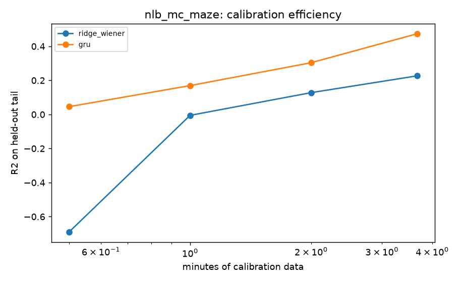
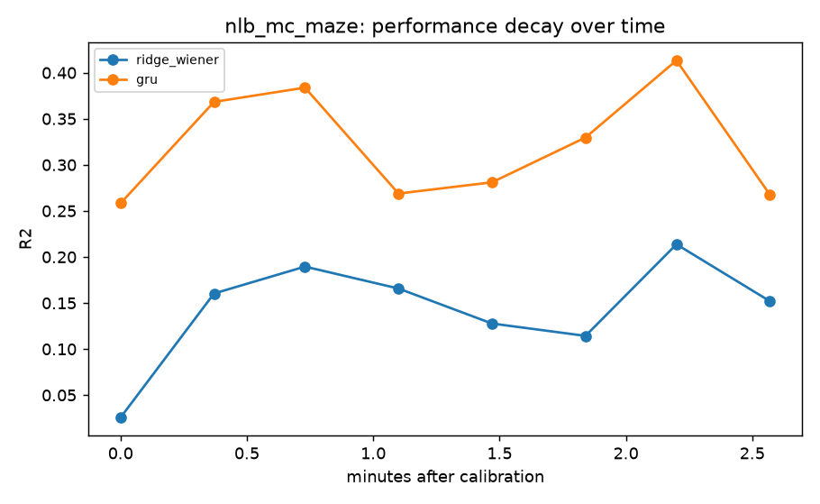
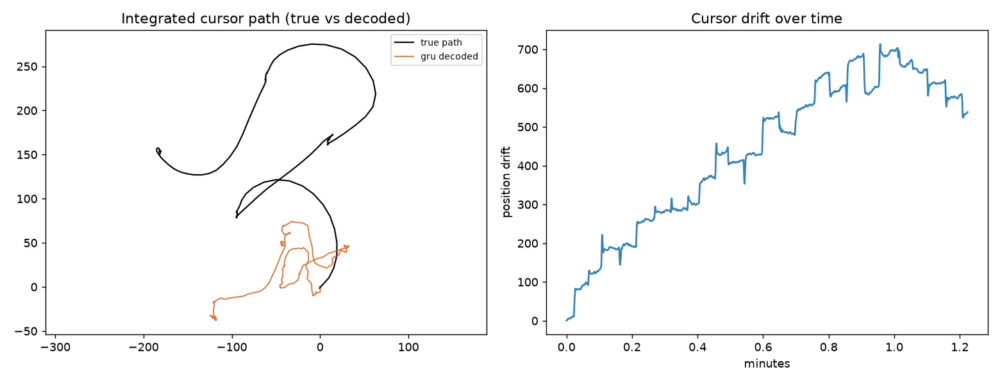

# Neural Decoder Zoo


  

Neural Decoder Zoo benchmarks brain-to-behavior decoders on synthetic motor data and public NLB MC_Maze intracortical recordings.

It compares ridge/Wiener, Kalman, reduced-rank, MLP, TCN, GRU, and causal transformer decoders with temporal splits, blocked cross-validation, latency, calibration-efficiency, nonstationarity, channel-dropout, and artifact-validity checks.

Headline results:

- MC_Maze: transformer R² 0.57, TCN R² 0.51, ridge/Wiener R² 0.23.
- Synthetic reach: reduced-rank and ridge/Wiener reach R² 0.95; sequence models do not improve the result.
- Artifact check: a magnitude metric increases under injected stimulation-like artifact, while behavior-tied R² drops.

---

## Quickstart

```bash
pip install -e ".[dev]"          # core: numpy, scikit-learn, matplotlib, pytest
python -m ndz.run --dataset synthetic            # run the zoo, print a table, save figures
python -m ndz.run --dataset synthetic --robustness   # + channel-dropout + signal-validity demo
pytest -q                        # tests (no torch required)

# full model zoo (adds MLP / TCN / GRU / transformer):
pip install -e ".[dev,torch]"
python -m ndz.run --dataset synthetic
```

## Why this repo exists

This is a compact, reproducible benchmark for the kinds of tradeoffs that matter in brain-computer-interface decoding: simple baselines, sequence models, temporal generalization, calibration burden, latency, robustness, and artifact-aware validation. It is designed to run quickly from a fresh clone while still connecting to a public intracortical dataset.

## Example results

Two datasets, identical code, 25% held-out **temporal** tail. Metrics: **R²** + **corr** (regression) and per-sample **inference latency** (µs).

**Synthetic reach** (cosine-tuned population, no download):

| decoder | R² | corr | latency (µs) |
|---|---|---|---|
| `reduced_rank` | **0.95** | 0.98 | 123 |
| `ridge_wiener` | 0.95 | 0.97 | 96 |
| `tcn` | 0.94 | 0.97 | 2505 |
| `transformer` | 0.94 | 0.97 | 1009 |
| `gru` | 0.92 | 0.96 | 445 |
| `mlp` | 0.91 | 0.95 | 42 |
| `kalman` | 0.80 | 0.97 | 7031 |

**MC_Maze** (real macaque M1/PMd → hand velocity; NLB, DANDI:000140):

| decoder | R² | corr | latency (µs) |
|---|---|---|---|
| `transformer` | **0.57** | 0.76 | 1420 |
| `tcn` | 0.51 | 0.76 | 2720 |
| `gru` | 0.47 | 0.70 | 397 |
| `mlp` | 0.25 | 0.65 | 115 |
| `ridge_wiener` | 0.23 | 0.48 | 104 |
| `reduced_rank` | 0.17 | 0.41 | 148 |
| `kalman` | −0.02 | 0.38 | 26556 |

The synthetic dataset is close to linear. Reduced-rank and ridge/Wiener are the top models. MC_Maze has stronger temporal structure. Sequence models roughly double to triple the ridge/Wiener baseline. The transformer leads the single split and cross-validation, but the transformer and TCN error bars overlap.

_Regenerate: `make demo` (synthetic) or `python -m ndz.run --dataset mc_maze --nwb-path <file> --cv --robustness` (after the NLB download below)._

## The decoder lineup

| Decoder | Family | Notes |
|---|---|---|
| `ridge_wiener` | Linear | Ridge-regularized Wiener filter with spike-history lags |
| `kalman` | Linear-Gaussian state space | Wu et al. style kinematic Kalman filter |
| `reduced_rank` | Linear, latent | PCA population projection followed by ridge regression |
| `mlp` | Feedforward NN | Windowed spike history → MLP *(torch)* |
| `tcn` | Temporal conv net | Dilated causal convolutions over the population *(torch)* |
| `gru` | Recurrent | GRU over a causal window; captures temporal dynamics *(torch)* |
| `transformer` | Causal self-attention | Small causal transformer over the window *(torch)* |

Every decoder implements the same `fit(X, Y) → predict(X)` interface (`ndz.decoders.base.Decoder`), so adding one is a single file.

## Evaluation methodology

- **Contiguous temporal split, no shuffling.** Train on the earlier block, test on the later one. Neural time series are autocorrelated, so a shuffled split leaks the future into training and inflates the score. Error bars come from blocked k-fold CV with an embargo gap.
- **BCI metrics:** R² / correlation, per-sample inference latency, channel-dropout degradation, calibration efficiency, and stability over time.

## Robustness and Signal Validity

`python -m ndz.run --robustness` runs two probes:

1. **Channel dropout:** decode quality as a function of electrodes removed.
2. **Artifact validity:** inject periodic saturating stimulation-like artifact into held-out features, then compare two measurements:
   - magnitude metric: peak deflection
   - behavior-tied metric: R² against true kinematics

The artifact increases the magnitude metric. It does not improve behavior-tied R². Use behavior-linked validation for neural-decoding claims.



## Additional Evaluations

The repository includes four additional BCI-oriented checks.

**Cross-validated comparison.** 3-fold blocked CV with an embargo gap, all seven models. Transformer and TCN are the top models. Their error bars overlap. Linear models are lower.


**Calibration efficiency.** R² on a fixed held-out block vs minutes of training data. GRU reaches usable accuracy with less calibration data than ridge/Wiener (`--calibration`).



**Nonstationarity.** R² in successive windows after calibration (`--nonstationarity`).



**Open-loop cursor.** Integrate decoded velocity into a 2-D cursor path. At R²≈0.47, the path drifts over time (normalized drift ~1.9). This is an offline trajectory check, not a closed-loop evaluation (`--cursor`).



## Validation protocols: how the split decides the score

The same decoder can look good or poor depending on how test data is separated from training data. `ndz.validation` scores one decoder under five protocols: random slices, purged random, blocked in time, held-out recording and held-out subject. It reports per-subject scores and subject-bootstrap CIs. On synthetic data with a slow target and individual mappings, random slices report r = 0.73 while a new subject gets 0.16. Write-up, protocols and real-data case studies (pending): [docs/VALIDATION.md](docs/VALIDATION.md). No download needed:

```bash
python -m ndz.validation.demo    # table + docs/validation_gap_synthetic.png
```

## Datasets

- **Synthetic:** cosine-tuned Poisson population encoding a smooth 2-D reach velocity. Decodable, deterministic by seed.
- **MC_Maze (Neural Latents Benchmark):** macaque M1/PMd spikes → hand velocity; public, de-identified animal data on DANDI. The **Small** split (DANDI:000140, ~29 MB) is the quick path; the full set is DANDI:000128 (~0.7 GB).
  ```bash
  pip install -e ".[nlb]"
  # download the ~29 MB MC_Maze_Small train file (behavior+ecephys):
  dandi download "DANDI:000140/sub-Jenkins/sub-Jenkins_ses-small_desc-train_behavior+ecephys.nwb"
  python -m ndz.run --dataset mc_maze --nwb-path sub-Jenkins_ses-small_desc-train_behavior+ecephys.nwb
  ```
  Results above were produced with this file (14,683 bins × 142 units, 20 ms bins).

## Limitations

- This is an offline benchmark. It does not evaluate closed-loop user control.
- MC_Maze is public macaque data. It is not human clinical BCI data.
- The sequence models are compact reference implementations. They are not tuned production models.
- Cross-session generalization, adaptive recalibration, and foundation-model pretraining are future work.

## Repository structure

```
src/ndz/
  data/        synthetic generator + NLB loader + NeuralDataset container
  decoders/    ridge, kalman, reduced_rank, mlp, tcn, gru, transformer (common interface)
  metrics.py   R2 / corr / accuracy / inference latency
  robustness.py channel dropout + stim-artifact injection + magnitude metric
  experiments.py calibration efficiency, nonstationarity, cursor simulation
  evaluate.py  temporal split + decoder evaluation + blocked cross-validation
  validation/  split protocols, validation-gap scoring, synthetic regimes, case-study loader + figure
  run.py       CLI: tables + figures (zoo / robustness / cv / calibration / cursor)
tests/         pytest suite (runs without torch)
case_studies/  real-data validation-gap scores (no raw data) + schema
docs/          committed result figures
configs/       default experiment config
```

## Roadmap

- [x] Wire MC_Maze numbers alongside synthetic in the results table
- [x] Reduced-rank latent baseline and a causal transformer rung
- [x] Cross-validated comparison with error bars (blocked k-fold + embargo)
- [x] Calibration-efficiency curve (R² vs minutes of training data)
- [x] Nonstationarity / decay-after-calibration curve
- [x] Open-loop cursor trajectory simulation
- [ ] Full LFADS-style latent-dynamics model
- [ ] Cross-session / cross-subject pretraining (the NDT / POYO / Brain-JEPA direction)
- [ ] True closed-loop evaluation with an adaptive user model


## License

MIT © 2026 Sanil Desai
