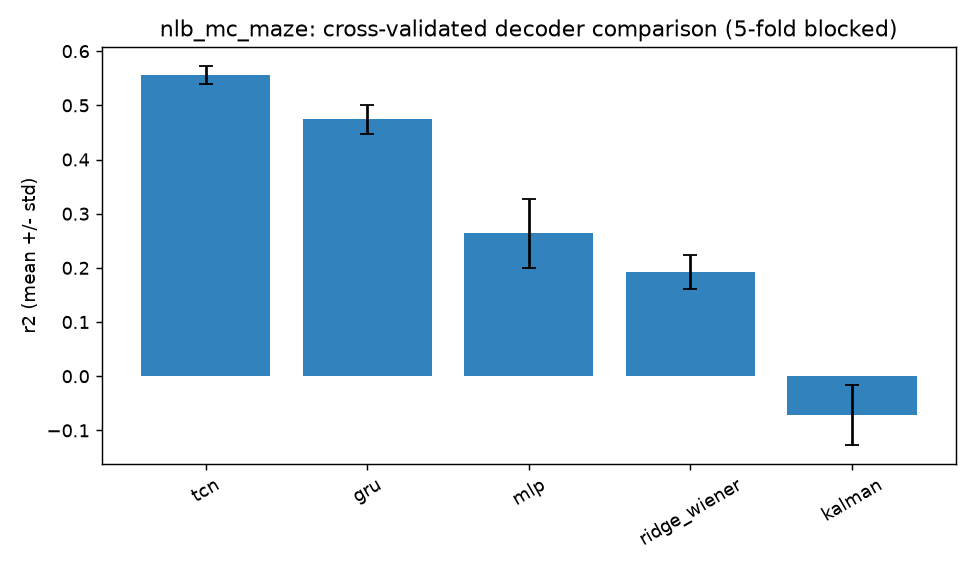

# Neural Decoder Zoo


  

A ladder of neural decoders, built for learning: a ridge/Wiener filter, a Kalman filter, a reduced-rank latent decoder, and MLP / TCN / GRU / transformer sequence models. Evaluated by held-out **temporal** generalization, **inference latency**, **robustness to channel loss**, calibration efficiency, and **signal validity**.

It runs end-to-end on a synthetic motor-decoding dataset, and plugs into the public **Neural Latents Benchmark (MC_Maze)** for real intracortical data.

---

## Quickstart

```bash
pip install -e ".[dev]"          # core: numpy, scikit-learn, matplotlib, pytest
python -m ndz.run --dataset synthetic            # run the zoo, print a table, save figures
python -m ndz.run --dataset synthetic --robustness   # + channel-dropout + signal-validity demo
pytest -q                        # tests (no torch required)

# full model zoo (adds MLP / GRU / TCN):
pip install -e ".[dev,torch]"
python -m ndz.run --dataset synthetic
```

## Example results

Two datasets, identical code, 25% held-out **temporal** tail. Metrics: **R²** + **corr** (regression) and per-sample **inference latency** (µs).

**Synthetic reach** (cosine-tuned population, no download):

| decoder | R² | corr | latency (µs) |
|---|---|---|---|
| `reduced_rank` | **0.95** | 0.98 | 123 |
| `ridge_wiener` | 0.95 | 0.97 | 96 |
| `tcn` | 0.94 | 0.97 | 2505 |
| `transformer` | 0.94 | 0.97 | 1009 |
| `gru` | 0.92 | 0.96 | 445 |
| `mlp` | 0.91 | 0.95 | 42 |
| `kalman` | 0.80 | 0.97 | 7031 |

**MC_Maze** (real macaque M1/PMd → hand velocity; NLB, DANDI:000140):

| decoder | R² | corr | latency (µs) |
|---|---|---|---|
| `transformer` | **0.57** | 0.76 | 1420 |
| `tcn` | 0.51 | 0.76 | 2720 |
| `gru` | 0.47 | 0.70 | 397 |
| `mlp` | 0.25 | 0.65 | 115 |
| `ridge_wiener` | 0.23 | 0.48 | 104 |
| `reduced_rank` | 0.17 | 0.41 | 148 |
| `kalman` | −0.02 | 0.38 | 26556 |

On clean synthetic data the linear family wins (reduced-rank and ridge top the table, the neural nets add nothing). On real MC_Maze the sequence models (transformer, TCN, GRU) roughly double to triple the linear baseline. The transformer edged ahead on this single split, but the cross-validated error bars below show how close the top sequence models actually are, which is exactly why you don't trust a single-split ranking.

_Regenerate: `make demo` (synthetic) or `python -m ndz.run --dataset mc_maze --nwb-path <file> --cv --robustness` (after the NLB download below)._

## The decoder lineup

| Decoder | Family | Notes |
|---|---|---|
| `ridge_wiener` | Linear | Ridge-regularized Wiener filter with spike-history lags — the baseline to beat |
| `kalman` | Linear-Gaussian state space | Wu et al.–style kinematic Kalman filter; the classic online BCI decoder |
| `reduced_rank` | Linear, latent | PCA the population to a low-dim neural manifold, then ridge from it; cheap cousin of LFADS |
| `mlp` | Feedforward NN | Windowed spike history → MLP *(torch)* |
| `tcn` | Temporal conv net | Dilated causal convolutions over the population *(torch)* |
| `gru` | Recurrent | GRU over a causal window; captures temporal dynamics *(torch)* |
| `transformer` | Causal self-attention | Small causal transformer over the window; data-hungry, shines at scale not on one session *(torch)* |

Every decoder implements the same `fit(X, Y) → predict(X)` interface (`ndz.decoders.base.Decoder`), so adding one is a single file.

## Evaluation methodology

- **Contiguous temporal split, no shuffling.** Train on the earlier block, test on the later one. Neural time series are autocorrelated, so a shuffled split leaks the future into training and inflates the score; a temporal split is the honest analogue of calibrate-then-use. Error bars come from blocked k-fold CV with an embargo gap.
- **BCI-relevant metrics, not just accuracy:** R² / correlation, plus per-sample **inference latency** (µs), **channel-dropout robustness**, calibration efficiency, and stability over time.

## Robustness & signal validity (the differentiating part)

`python -m ndz.run --robustness` runs two probes:

1. **Channel dropout** — decode quality as a function of % electrodes lost (graceful degradation matters for a chronic implant).
2. **Signal-validity demo** — inject periodic saturating "stim-like" artifact into the held-out features, then judge "is there signal here?" two ways:
   - a tempting **magnitude metric** (peak deflection) — the artifact inflates it ~35× on real data
   - a **behavior-tied metric** (R² against true kinematics) — the artifact does not inflate it; it drops

The lesson, learned the hard way on real stimulation data: validate against behavior, not signal size. A metric that rewards raw response magnitude will happily "discover" artifact.


## Rigor & deployment

Beyond a single accuracy number, the zoo probes what a real BCI actually cares about.

**Cross-validated comparison (error bars).** 5-fold blocked CV with an embargo gap, across the core models. Averaged over folds, **TCN is the robust leader** — a useful counter to the single-split table above, where the transformer happened to nudge ahead. That gap between a single split and the cross-validated ranking is the whole point of showing error bars. (Cross-validating the two newest rungs, transformer and reduced-rank, is a quick follow-up.)



**Calibration efficiency.** R² on a fixed held-out block vs minutes of training data. The GRU reaches usable accuracy with far less calibration than the linear model needs — the calibration burden is one of the biggest real-world BCI constraints (`--calibration`).


**Nonstationarity.** R² in successive windows after calibration — the drift a chronic decoder has to fight (`--nonstationarity`).


**Open-loop cursor.** Integrate the decoded velocity into a 2-D cursor path. Even at R²≈0.47 the path drifts away over time (normalized drift ~1.9), which is exactly why real BCIs run closed-loop with the user correcting in real time (`--cursor`).


## Datasets

- **Synthetic**  — cosine-tuned Poisson population encoding a smooth 2-D reach velocity. Decodable, deterministic by seed.
- **MC_Maze (Neural Latents Benchmark)** — macaque M1/PMd spikes → hand velocity; public, de-identified animal data on DANDI. The **Small** split (DANDI:000140, ~29 MB) is the quick path; the full set is DANDI:000128 (~0.7 GB).
  ```bash
  pip install -e ".[nlb]"
  # download the ~29 MB MC_Maze_Small train file (behavior+ecephys):
  dandi download "DANDI:000140/sub-Jenkins/sub-Jenkins_ses-small_desc-train_behavior+ecephys.nwb"
  python -m ndz.run --dataset mc_maze --nwb-path sub-Jenkins_ses-small_desc-train_behavior+ecephys.nwb
  ```
  Results above were produced with this file (14,683 bins × 142 units, 20 ms bins).

## Repository structure

```
src/ndz/
  data/        synthetic generator + NLB loader + NeuralDataset container
  decoders/    ridge, kalman, reduced_rank, mlp, tcn, gru, transformer (common interface)
  metrics.py   R2 / corr / accuracy / inference latency
  robustness.py channel dropout + stim-artifact injection + magnitude metric
  experiments.py calibration efficiency, nonstationarity, cursor simulation
  evaluate.py  temporal split + decoder evaluation + blocked cross-validation
  run.py       CLI: tables + figures (zoo / robustness / cv / calibration / cursor)
tests/         pytest suite (runs without torch)
docs/          committed result figures
configs/       default experiment config
```

## Roadmap

- [x] Wire MC_Maze numbers alongside synthetic in the results table
- [x] Reduced-rank latent baseline and a causal transformer rung
- [x] Cross-validated comparison with error bars (blocked k-fold + embargo)
- [x] Calibration-efficiency curve (R² vs minutes of training data)
- [x] Nonstationarity / decay-after-calibration curve
- [x] Open-loop cursor trajectory simulation
- [ ] Full LFADS-style latent-dynamics model
- [ ] Cross-session / cross-subject pretraining (the NDT / POYO / Brain-JEPA direction)
- [ ] True closed-loop evaluation with an adaptive user model


## License

MIT © 2026 Sanil Desai
