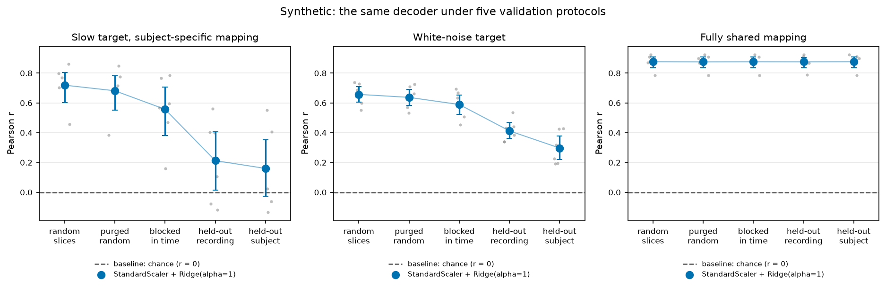

# How you split the data decides the score

## The question

A decoder's reported score depends on how the test data was separated from the
training data, not just on the decoder. Neural and behavioural signals change
slowly. If test samples are drawn at random from a recording, each one has
near neighbours in time in the training set, and the decoder is partly graded
on data it has effectively already seen. A later stretch of the same recording
is harder. A person the decoder has never seen is harder still, and that is
the case that matters for a clinical device.

This page asks how large that difference is, on synthetic data where the
answer is known and on public human datasets.

## The protocols in plain words

| protocol | what is held out | what it answers |
|---|---|---|
| `random_slices` | random samples from anywhere | the usual check; the most flattering |
| `purged_random` | random samples, and training samples within an embargo of them are removed | how much of the random-slice score comes from immediate neighbours |
| `blocked_in_time` | a contiguous block of each recording (`last_fraction`: its end) | will it keep working later in the same session? |
| `held_out_recording` | a whole recording, with the same people still in training | will it work in this person's next session? |
| `held_out_subject` | every recording of one person | will it work for a new patient? |

The **optimism** is `random_slices − held_out_subject`: how much the usual
check overstates performance for a new person.

Implementation: `ndz.validation.splits` (index generators), `ndz.validation.gap`
(scoring). Scalers and feature selection are fit inside each training fold
through an sklearn `Pipeline`.

Scoring: each subject is scored once per protocol, on all of that subject's
out-of-fold predictions pooled across folds. A subject is never scored on the
few rows one fold happens to hold out; that number differs between protocols
and would create a gap by itself. The protocol score is the mean of the
subject scores, and its 95% CI is a percentile bootstrap that resamples
subjects. A subject whose score is undefined (a constant target or prediction
for Pearson r or R², a single class for balanced accuracy) is left out of the
mean and listed in `skipped` with the reason. The optimism has a paired
bootstrap CI over the subjects scored under both protocols.

## What `held_out_recording` scores

Recording ids are scoped by subject: `R0` of subject `S1` and `R0` of `S2` are
different recordings. The protocol makes one fold per recording that belongs to
a subject with at least one other recording. The fold's test set is that whole
recording. Its training set is everything else: the same subject's other
recordings and all recordings of all other subjects.

- **Subjects with two or more recordings** are scored. Each of their recordings
  is tested once, and the subject's score pools all of those predictions.
- **Subjects with exactly one recording** are never tested, because leaving out
  their only recording would be a held-out subject, which `held_out_subject`
  already measures. Their samples are in every training set. They are not in
  `per_subject` or `n_subjects_scored`, they appear in `skipped` as
  `"not tested by held_out_recording"`, and `n_test_samples` is smaller than
  the number of rows. The protocol score is the mean over the remaining
  subjects only, so with mixed data it averages a smaller set of people than
  the other protocols do.
- **No subject with two recordings** gives no folds. `evaluate_protocol` raises
  `ValueError: protocol 'held_out_recording' produced no folds for this data`, and so
  does `validation_gap` with its default five protocols; pass the protocols you
  want to avoid it.
- **A subject with an undefined score** (for example a constant target) is
  skipped with the reason, as in every protocol.

In the synthetic demo every subject has two recordings: 12 folds, all 6
subjects scored, all 3600 rows tested, nothing skipped. The optimism does not
use this protocol (it is `random_slices − held_out_subject`).

## Synthetic result

Run it with `python -m ndz.validation.demo` (no downloads, under a minute).

The data has 6 subjects × 2 recordings × 300 samples and 48 channels. The
decoder is StandardScaler + Ridge, scored by Pearson r. Each regime changes
one setting from the first (`ndz.validation.synthetic.REGIMES`):

1. **Slow target, subject-specific mapping.** The target is AR(1) with
   ρ = 0.99. 85% of the variance of the target-to-channel mapping is specific to each subject,
   and that part also carries slow, recording-specific channel drift.
2. **White-noise target.** The same as 1, with ρ = 0. The channel drift is
   unchanged (`drift_scale = 2.5`).
3. **Fully shared mapping.** The same as 1, with every subject using one
   mapping, so there is no subject-specific part and no drift.

Seed 0, score [95% CI]:

| protocol | slow target, subject-specific | white-noise target | fully shared mapping |
|---|---|---|---|
| `random_slices` | 0.72 [0.60, 0.81] | 0.66 [0.60, 0.71] | 0.88 [0.84, 0.91] |
| `purged_random` | 0.68 [0.55, 0.78] | 0.64 [0.58, 0.69] | 0.88 [0.84, 0.91] |
| `blocked_in_time` | 0.56 [0.38, 0.71] | 0.59 [0.52, 0.65] | 0.88 [0.84, 0.91] |
| `held_out_recording` | 0.21 [0.01, 0.41] | 0.41 [0.36, 0.47] | 0.88 [0.84, 0.91] |
| `held_out_subject` | 0.16 [−0.03, 0.35] | 0.30 [0.22, 0.38] | 0.88 [0.84, 0.91] |
| **optimism** | **+0.56** | **+0.36** | **+0.00** |

What the regimes show:

- **A slow target with a subject-specific mapping** is the realistic case. The
  usual check reports r = 0.72, but a new person gets 0.16, and its CI includes
  zero. Purging immediate neighbours removes little of that gap (0.68; 0.04 on
  average over seeds 0–19). Blocking in time removes much more (0.56). Most of
  the inflation therefore does not come from adjacent samples.
- **A white-noise target** still leaves a small gap between random slices and
  blocked splits (0.66 and 0.59 on seed 0). Time carries no information about
  the target here, so the gap is smaller than in regime 1 (mean +0.06, against
  +0.18 over seeds 0–19). It comes from the slow channel drift, not from the
  scoring; see below. A new person costs a lot (0.30), because the mapping is
  individual.
- **A fully shared mapping** makes a new person as easy as a random slice
  (0.88 and 0.88). All five protocols agree to within 0.004 on every seed
  0–19.

### The white-noise gap comes from channel drift

Random slices minus blocked in time, white-noise target, Ridge(alpha=1),
Pearson r, seeds 0–19 (scores are means over the 20 seeds; the gap column also
gives the per-seed range):

| channel drift | `random_slices` | `blocked_in_time` | gap |
|---|---|---|---|
| default (`drift_scale = 2.5`) | 0.641 | 0.583 | +0.059 (+0.040 to +0.074) |
| off (`drift_scale = 0`) | 0.807 | 0.807 | +0.000 (−0.001 to +0.002) |

With drift off the two protocols agree on every seed. With drift on, both
scores fall, and the blocked score falls more: by 0.224 against 0.165 for
random slices, and more on all 20 seeds. A plausible reason is that a
random-slice decoder was trained on the same stretch of drift it is tested on,
and a held-out time block shows it a drift state it has not seen. This sweep
shows that the gap needs the drift; it does not isolate that explanation.

The tests (`tests/test_validation.py`) check regimes 1 and 3 on seeds 0–2. Their
margins hold on seeds 0–19: random minus blocked is at least 0.105 and blocked
minus held-out subject at least 0.123 in regime 1, and the shared-mapping
optimism is at most 0.001 in size. For regime 2 the tests run seeds 0–19 and
check the mechanism: the gap is below 0.005 with drift off, and between 0.02
and 0.10 with the default drift. `tests/test_validation_acceptance.py` checks
the split generators against brute-force definitions, that preprocessing is fit
on training rows only, and that a decoder with nothing to exploit shows no gap.

## Real-data case studies (pending)

> **Pending.** These results are being produced from three public human
> datasets and will be loaded from `case_studies/<dataset>/results.json` (schema:
> [`case_studies/README.md`](../case_studies/README.md)). No raw data is
> redistributed. Once results are present, `python -m ndz.validation.demo`
> writes `docs/validation_gap.png`.

| dataset | task / metric | n subjects | random slices | purged random | blocked in time | held-out recording | held-out subject | optimism | published claim |
|---|---|---|---|---|---|---|---|---|---|
| `mer_stn` | | | | | | | | | |
| `grip_force_ecog` | | | | | | | | | |
| `meg_muscle_drive` | | | | | | | | | |

## Limitations

- The synthetic generator is built to show the mechanism. The size of the gap
  in real data is an empirical question, which is what the case studies are for.
- The bootstrap resamples only a handful of subjects, so the CIs are wide and
  approximate.
- Only offline decoding is evaluated. A closed-loop user adapts to the decoder,
  which changes what "held out" means.
